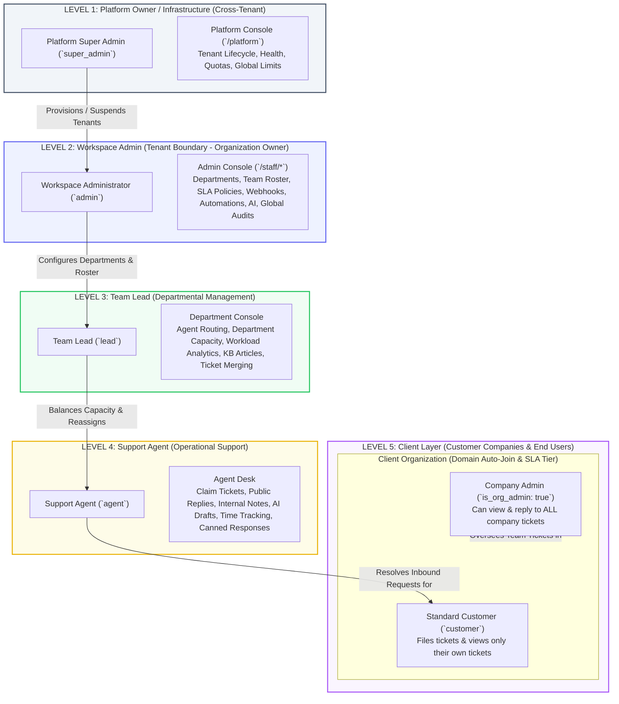

# DeskFlow Platform Architecture & Management Hierarchy

DeskFlow is built on an enterprise multi-tenant, role-isolated architecture with strict zero-trust boundaries between platform infrastructure, individual workspaces, operational departments, support staff, and end customers.

---

## 1. High-Level Hierarchy Diagram

---

## 2. Detailed Level Breakdown

### Level 1: Platform Super Admin (`super_admin`)
* **Role**: Platform Owner / Infrastructure Operator.
* **Scope**: Entire SaaS platform across all tenant instances.
* **Frontend Route**: `/platform` ([`PlatformPage.jsx`](file:///C:/Users/91897/Desktop/deskflow/deskflow-frontend/src/pages/platform/PlatformPage.jsx)) protected by [`RequirePlatform`](file:///C:/Users/91897/Desktop/deskflow/deskflow-frontend/src/App.jsx#L67-L72).
* **Backend Controllers & Routes**:
  * Routes: [`routes/platform.php`](file:///C:/Users/91897/Desktop/deskflow/deskflow-api/routes/platform.php)
  * Controller: [`PlatformTenantController.php`](file:///C:/Users/91897/Desktop/deskflow/deskflow-api/app/Http/Controllers/Api/V1/Platform/PlatformTenantController.php)
* **Core Responsibilities**:
  1. **Tenant Lifecycle**: Provision new workspaces, rename slugs, suspend non-paying or violating tenants, or permanently erase workspaces via [`TenantEraser.php`](file:///C:/Users/91897/Desktop/deskflow/deskflow-api/app/Services/TenantEraser.php).
  2. **Infrastructure Health**: Inspect database connectivity, redis cache latency, and queue worker status via [`OpsHealth.php`](file:///C:/Users/91897/Desktop/deskflow/deskflow-api/app/Services/OpsHealth.php).
  3. **Global Metrics**: View cross-tenant aggregate counts (workspaces, staff seats, customer accounts, and monthly ticket totals).
* **Isolation Rule**:
  > [!IMPORTANT]
  > As enforced in [`ResolveTenant.php`](file:///C:/Users/91897/Desktop/deskflow/deskflow-api/app/Http/Middleware/ResolveTenant.php#L26-L28), Super Admins **cannot** enter an individual workspace or access ticket data, private notes, attachments, or client customer lists.

---

### Level 2: Workspace Administrator (`admin`)
* **Role**: Tenant Administrator / Support Organization Owner.
* **Scope**: Entire single workspace (`Tenant`).
* **Frontend Route**: `/staff` ([`StaffLayout.jsx`](file:///C:/Users/91897/Desktop/deskflow/deskflow-frontend/src/pages/staff/StaffLayout.jsx)) with full admin navigation.
* **Backend Controllers**:
  * [`WorkspaceSettingsController.php`](file:///C:/Users/91897/Desktop/deskflow/deskflow-api/app/Http/Controllers/Api/V1/WorkspaceSettingsController.php)
  * [`UserController.php`](file:///C:/Users/91897/Desktop/deskflow/deskflow-api/app/Http/Controllers/Api/V1/UserController.php)
  * [`DepartmentController.php`](file:///C:/Users/91897/Desktop/deskflow/deskflow-api/app/Http/Controllers/Api/V1/DepartmentController.php)
  * [`OrganizationController.php`](file:///C:/Users/91897/Desktop/deskflow/deskflow-api/app/Http/Controllers/Api/V1/OrganizationController.php)
  * [`AutomationRuleController.php`](file:///C:/Users/91897/Desktop/deskflow/deskflow-api/app/Http/Controllers/Api/V1/AutomationRuleController.php)
  * [`WebhookController.php`](file:///C:/Users/91897/Desktop/deskflow/deskflow-api/app/Http/Controllers/Api/V1/WebhookController.php)
* **Core Responsibilities**:
  1. **Workspace Settings**: Branding (logo, theme color), working days, timezone, and security controls (e.g. enforce mandatory 2FA for all staff).
  2. **Team & Roster**: Invite staff, assign roles (`lead`, `agent`, `admin`), adjust routing capacities, suspend or delete inactive team members.
  3. **Department Configuration**: Structure support divisions (e.g., *Billing*, *Tier 2 Tech*), business hours, and dynamic intake forms.
  4. **Client Organizations**: Create B2B customer organizations, assign enterprise SLA tiers (Standard, Silver, Gold, Platinum), and set seat quotas.
  5. **Automations & Webhooks**: Construct event rules, configure inbound email processing, and dispatch notifications to Slack/Teams webhooks.
  6. **Compliance & SLA**: Define target response and resolution deadlines, set official company holidays, and export comprehensive audit logs.

---

### Level 3: Department Team Lead (`lead`)
* **Role**: Departmental Supervisor / Escalation Manager.
* **Scope**: Assigned department(s) within the workspace.
* **Frontend Route**: `/staff` (Departmental views and management tools).
* **Core Responsibilities**:
  1. **Workload Balancing**: Toggle agent routing availability (`is_available_for_routing`) and modify agent concurrent ticket limits (`max_active_tickets`) in [`UserController.php`](file:///C:/Users/91897/Desktop/deskflow/deskflow-api/app/Http/Controllers/Api/V1/UserController.php#L174-L188).
  2. **Ticket Oversight**: View and manage all tickets belonging to their department. Reassign agents, escalate priorities, and merge duplicate tickets in [`TicketCollaborationController.php`](file:///C:/Users/91897/Desktop/deskflow/deskflow-api/app/Http/Controllers/Api/V1/TicketCollaborationController.php#L58-L95).
  3. **Performance Analytics**: Review department SLA compliance rates, at-risk deadlines, resolution trends, and agent CSAT scores in [`SlaAnalyticsController.php`](file:///C:/Users/91897/Desktop/deskflow/deskflow-api/app/Http/Controllers/Api/V1/SlaAnalyticsController.php).
  4. **Knowledge Base**: Author, edit, publish, and review search analytics for help articles in [`ArticleController.php`](file:///C:/Users/91897/Desktop/deskflow/deskflow-api/app/Http/Controllers/Api/V1/ArticleController.php).
* **Isolation Rule**:
  > [!NOTE]
  > Team leads are restricted by policy to tickets matching their `department_id` unless explicitly invited to another ticket as a watcher or collaborator.

---

### Level 4: Support Agent (`agent`)
* **Role**: Front-line Support Representative.
* **Scope**: Directly assigned tickets and the unassigned department claiming pool.
* **Frontend Route**: `/staff` (Ticket Queue, Detail Desk, Canned Responses).
* **Core Responsibilities**:
  1. **Ticket Processing**: Claim unassigned tickets from their department pool, post public replies to customers, and add private internal notes.
  2. **AI Assistance**: Generate contextual AI drafts, summarize ticket history, translate foreign customer messages, and apply AI triage suggestions in [`TicketAiController.php`](file:///C:/Users/91897/Desktop/deskflow/deskflow-api/app/Http/Controllers/Api/V1/TicketAiController.php).
  3. **Productivity Tools**: Use personal canned responses, log work time entries, add watchers, and mention teammates via `@mentions`.
* **Isolation Rule**:
  > Enforced in [`TicketPolicy.php`](file:///C:/Users/91897/Desktop/deskflow/deskflow-api/app/Policies/TicketPolicy.php#L25-L28). Agents cannot view tickets outside their department pool or steal tickets already owned by another agent.

---

### Level 5: Client Layer (Customer Organizations & End Users)
* **Role**: Requesters & Customer Companies.
* **Scope**: Customer Portal ([`/portal`](file:///C:/Users/91897/Desktop/deskflow/deskflow-frontend/src/pages/portal/PortalLayout.jsx)).
* **Sub-Roles**:
  1. **Company Admin (`is_org_admin: true`)**:
     * Designated client lead at a customer company (e.g., IT lead at Acme Corp).
     * Automatically linked via email domain (`@acme.com`).
     * Permitted to view, track, and reply to **all tickets filed by colleagues** across their entire [`Organization`](file:///C:/Users/91897/Desktop/deskflow/deskflow-api/app/Models/Organization.php).
  2. **Standard Customer (`customer`)**:
     * Standard requester.
     * Can only submit tickets, view their own ticket history, upload attachments, and submit CSAT ratings.
* **Isolation Rule**:
  > Customers have no access to staff consoles (`/staff`), cannot view internal notes, and can only see tickets where `customer_id == user.id` (or matching their `organization_id` if they are a Company Admin).

---

## 3. Data Boundary & Enforcement Matrix

| Level | Role (`UserRole`) | Route & UI Scope | Database Scope | Key Enforcement Guard |
| :--- | :--- | :--- | :--- | :--- |
| **Level 1** | `super_admin` | `/platform/*` | Global `tenants` table | [`EnsureUserHasRole.php`](file:///C:/Users/91897/Desktop/deskflow/deskflow-api/app/Http/Middleware/EnsureUserHasRole.php#L27-L29), [`ResolveTenant.php`](file:///C:/Users/91897/Desktop/deskflow/deskflow-api/app/Http/Middleware/ResolveTenant.php#L26-L28) |
| **Level 2** | `admin` | `/staff/*` (All menus) | Scoped by `tenant_id` | [`BelongsToTenant.php`](file:///C:/Users/91897/Desktop/deskflow/deskflow-api/app/Tenancy/BelongsToTenant.php), [`TenantScope.php`](file:///C:/Users/91897/Desktop/deskflow/deskflow-api/app/Tenancy/TenantScope.php) |
| **Level 3** | `lead` | `/staff/*` (Dept restricted) | `tenant_id` + `department_id` | [`TicketPolicy.php`](file:///C:/Users/91897/Desktop/deskflow/deskflow-api/app/Policies/TicketPolicy.php#L24), [`UserController.php`](file:///C:/Users/91897/Desktop/deskflow/deskflow-api/app/Http/Controllers/Api/V1/UserController.php#L179-L183) |
| **Level 4** | `agent` | `/staff/tickets` | `tenant_id` + `assigned_agent_id` / pool | [`TicketPolicy.php`](file:///C:/Users/91897/Desktop/deskflow/deskflow-api/app/Policies/TicketPolicy.php#L25-L28), [`Ticket::scopeVisibleTo()`](file:///C:/Users/91897/Desktop/deskflow/deskflow-api/app/Models/Ticket.php#L77-L78) |
| **Level 5a** | `customer` (`is_org_admin`) | `/portal/*` (Org tickets) | `tenant_id` + `organization_id` | [`TicketPolicy.php`](file:///C:/Users/91897/Desktop/deskflow/deskflow-api/app/Policies/TicketPolicy.php#L23), [`Ticket.php`](file:///C:/Users/91897/Desktop/deskflow/deskflow-api/app/Models/Ticket.php#L74-L75) |
| **Level 5b** | `customer` | `/portal/*` (Own tickets) | `tenant_id` + `customer_id` | [`TicketPolicy.php`](file:///C:/Users/91897/Desktop/deskflow/deskflow-api/app/Policies/TicketPolicy.php#L22), [`Ticket.php`](file:///C:/Users/91897/Desktop/deskflow/deskflow-api/app/Models/Ticket.php#L74) |

---

## 4. Multi-Tenant Request Resolution Flow

1. **Incoming Request**: User connects via subdomain (e.g. `acme.deskflow.com`), query parameter (`?tenant=acme`), or `X-Tenant` header.
2. **Tenant Resolution**: [`ResolveTenant.php`](file:///C:/Users/91897/Desktop/deskflow/deskflow-api/app/Http/Middleware/ResolveTenant.php) verifies the workspace is active and sets [`TenantContext::set($tenant)`](file:///C:/Users/91897/Desktop/deskflow/deskflow-api/app/Tenancy/TenantContext.php).
3. **Database Scoping**: [`TenantScope`](file:///C:/Users/91897/Desktop/deskflow/deskflow-api/app/Tenancy/TenantScope.php) automatically injects `WHERE tenant_id = ?` into all Eloquent queries across Users, Tickets, Departments, Organizations, and Automations.
4. **Role & Permission Verification**: [`EnsureUserHasRole.php`](file:///C:/Users/91897/Desktop/deskflow/deskflow-api/app/Http/Middleware/EnsureUserHasRole.php) and [`TicketPolicy.php`](file:///C:/Users/91897/Desktop/deskflow/deskflow-api/app/Policies/TicketPolicy.php) enforce strict row-level access.
